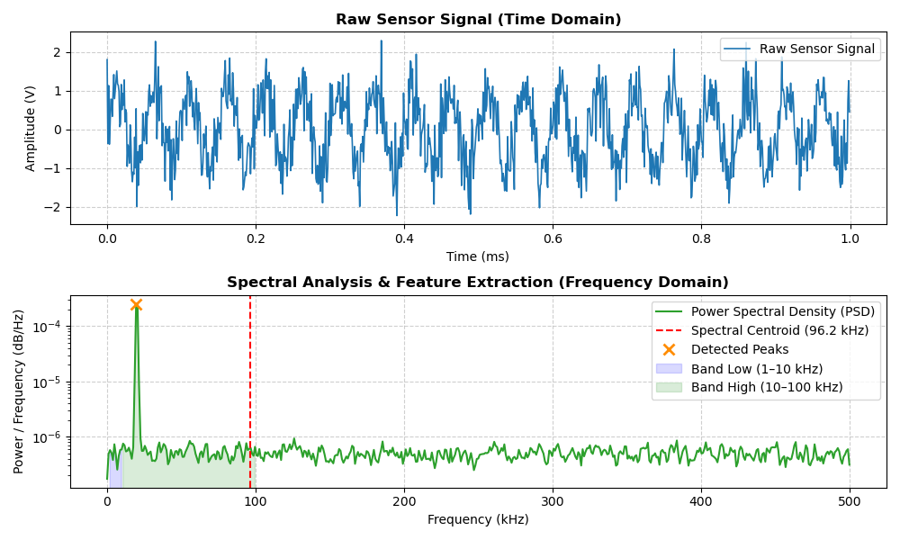

# High-Dimensional Signal Processing & Spectral Feature Extraction

This module extracts time-frequency features from raw sensor traces (e.g., optical emission spectroscopy or plasma probe voltage signals) for high-dimensional featurization.

## Technical Capabilities
- Computes Power Spectral Density (PSD) using Welch's method.
- Calculates physical signal metrics: Spectral Centroid, dominant peak emission frequencies, and diagnostic frequency band power ratios.
- Renders dual-panel plots displaying time-domain waveforms and frequency-domain spectral features.

  
